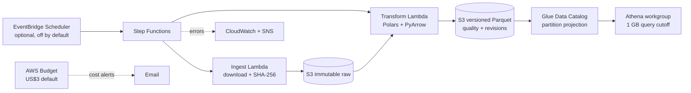

# NZ Migration Data Pipeline on AWS

[](https://github.com/liyang6620/nz-migration-data-pipeline-aws/actions/workflows/ci.yml)
[](pyproject.toml)
[](infrastructure/terraform)
[](LICENSE)

A revision-aware data engineering pipeline for official Statistics New Zealand
long-term migration arrivals data. It preserves every source release, validates
the source cube, publishes partitioned Parquet, and explains how estimates
change between releases.

The project is designed as a low-volume portfolio production system: the full
pipeline runs locally, the AWS runtime is containerised, and all cloud resources
are defined in Terraform. AWS V2 is intentionally not deployed from this branch
yet; infrastructure defaults keep compute and scheduling disabled until a plan
is reviewed.

## Why this exists

Stats NZ revises historical migration estimates. A dashboard that reads only
the newest CSV cannot reproduce what an analyst saw in an earlier reporting
cycle. This pipeline makes each release immutable and compares the same fact
across snapshots.

The source file is a three-dimensional cube:

```text
citizenship x visa x country_of_residence
```

Rows containing `TOTAL` are aggregations within that cube. Summing the complete
file would double-count the population, so the pipeline derives eight explicit
`metric_slice` values. Headline KPIs use only the triple-`TOTAL` slice.

## Architecture



There is no NAT Gateway, VPC, EC2, ECS, Redshift, QuickSight, MWAA, or Glue
Spark job in V2. Lambda concurrency is capped at one for each stage.

## What is implemented

- Strict executable source and canonical data contracts
- Immutable raw releases with SHA-256 conflict detection
- Polars transformation of the complete source cube
- Canonical business-key duplicate rejection
- Zstandard Parquet partitioned by snapshot month and activity month
- Atomic local publication and S3 commit-marker publication
- Idempotent reruns and interrupted-commit recovery
- Per-snapshot data quality evidence
- Full outer revision comparison: added, removed, revised, unchanged
- Container-based ingest and transform Lambda handlers
- Step Functions retries only for AWS service errors
- Quarantine records for rejected AWS transformations
- Least-privilege IAM roles, S3 encryption/versioning/TLS enforcement
- Optional failure alerts and project-tagged US$3 monthly budget
- CI for tests, lint, dependency audit, Terraform, and container build

## Verified full-release evidence

The local implementation was run against unmodified official release files,
with download digests checked before processing.

| Snapshot | Source rows | Activity partitions | SHA-256 |
|---|---:|---:|---|
| 2025-10 | 357,098 | 298 | `051978fc...a9396abf4` |
| 2025-11 | 358,233 | 299 | `976a8f39...913ae0` |

The November comparison produced 359,312 revision keys:

| Change type | Facts |
|---|---:|
| Added | 2,214 |
| Removed | 1,079 |
| Revised | 24,279 |
| Unchanged | 331,740 |

Sixteen headline total estimates changed. For example, October 2024 arrivals
were revised from **10,600** to **10,454**, a delta of **-146**. These figures
are generated from `_revisions/part-00000.parquet`, not hard-coded reporting
logic.

## Quick start

Requires Python 3.11 or newer.

```bash
python -m pip install -e ".[dev]"
python -m nz_migration_pipeline run-local \
  --source tests/fixtures/source_snapshot_2025_10.csv \
  --release-id fixture-2025-10 \
  --snapshot-month 2025-10 \
  --output-root .local/pipeline
```

The command prints a structured result with `processed` or `skipped`, row and
partition counts, source digest, output path, and run ID. An official URL can be
used as `--source`; pass `--expected-sha256` to pin its content.

See [the local pipeline guide](docs/local_pipeline.md) for layout and failure
semantics.

## Output contract

```text
pipeline/
  raw/release_id=<release-id>/
    source.csv
    manifest.json
  curated/migration_arrivals/
    snapshot_month=YYYY-MM/
      _SUCCESS.json
      _QUALITY.json
      _revisions/
        part-00000.parquet
        summary.json
      year_month=YYYY-MM/part-00000.parquet
  metadata/
    releases/<release-id>.json
    runs/<run-id>.json
```

The canonical key is:

```text
snapshot_month + year_month + passenger_type + direction
+ citizenship + visa + country_of_residence
```

The revision key removes `snapshot_month` so the same fact can be compared
across releases. See [data model](docs/data_model.md),
[data contract](docs/data_contract.md), and
[JSON Schema](contracts/canonical_fact.schema.json).

## Safe query example

```sql
SELECT year_month, estimate, standard_error, status
FROM nz_migration_v2.migration_arrivals
WHERE snapshot_month = '2025-11'
  AND metric_slice = 'total'
ORDER BY year_month;
```

Filtering `metric_slice = 'total'` is essential for a headline series. Other
slices support citizenship, visa, residence, and cross-tab analysis without
discarding source detail.

## AWS deployment

Terraform uses a two-step deployment because Lambda cannot reference a container
image before that image exists:

1. Apply with `deploy_compute = false` to create S3, ECR, Glue Catalog, and the
   Athena workgroup.
2. Build and push the Lambda image to the ECR output.
3. Pin `container_image_uri` to `repository@sha256:<digest>`.
4. Apply with `deploy_compute = true`.
5. Run a manual release successfully before enabling the optional schedule.

Full instructions and variables are in
[infrastructure/terraform](infrastructure/terraform). No AWS resource is
created by cloning or testing this repository.

## Cost boundary

Expected demo usage is normally below **US$1/month** and is designed to stay
below the **US$3/month** project budget:

| Service | Cost behaviour |
|---|---|
| S3 | Tens of MB per snapshot; no minimum instance charge |
| Lambda | Two short monthly invocations; concurrency capped at 1 |
| Step Functions | Two task transitions per successful release |
| Glue Catalog | Metadata only; no Glue Spark/DPU jobs |
| Athena | Pay per bytes scanned; workgroup rejects queries above 1 GB |
| ECR | Small image storage; only five images retained |
| CloudWatch/SNS | 30-day logs and failure-only notifications |

The estimate excludes unrelated AWS resources and data transfer anomalies.
Activate the `Project` cost allocation tag for the Terraform budget filter.

## Verification

```bash
pytest -q
ruff check src tests
python -m compileall -q src tests
terraform -chdir=infrastructure/terraform fmt -check -recursive
terraform -chdir=infrastructure/terraform validate
docker build --tag nz-migration-pipeline:local .
```

CI performs the same checks and audits Python dependencies. The committed test
fixtures are unmodified row subsets of official files and retain provenance in
`tests/fixtures/releases.json`.

## Repository map

| Path | Purpose |
|---|---|
| `src/nz_migration_pipeline/` | Contracts, Polars pipeline, revisions, CLI, Lambda adapters |
| `contracts/` | Machine-readable canonical schema |
| `infrastructure/terraform/` | Low-cost AWS V2 infrastructure |
| `tests/` | Unit, contract, integration, CLI, and AWS adapter tests |
| `docs/adr/` | Architecture decision records |
| `Athena/`, `Glue/`, `Stepfunction/` | Legacy V1 evidence retained for migration comparison |

## Scope and attribution

The verified source currently supports **long-term migrant arrivals only**. It
does not contain departures or net migration, and this repository does not
claim otherwise. It is a reporting and reproducibility pipeline, not a forecast
or policy model.

Source data is published by [Stats NZ](https://www.stats.govt.nz/) under the
Creative Commons Attribution 4.0 International licence. Repository code is
licensed under [MIT](LICENSE). Outputs are independent transformations and are
not official Stats NZ publications.
